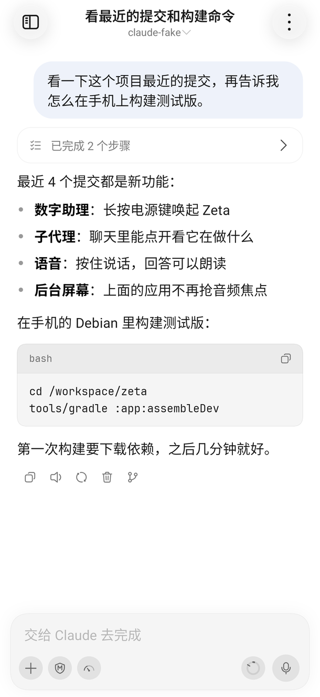
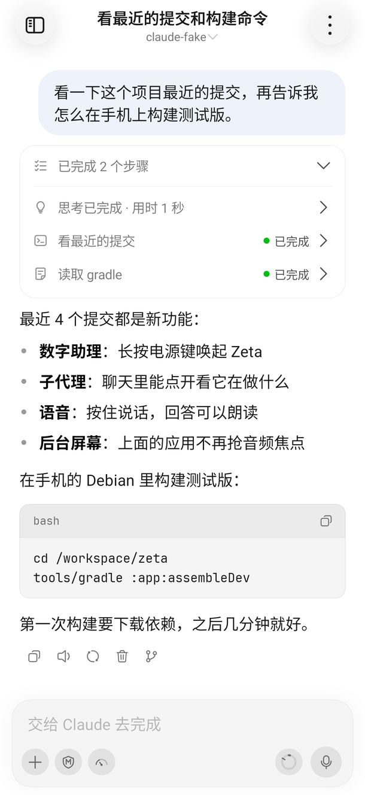
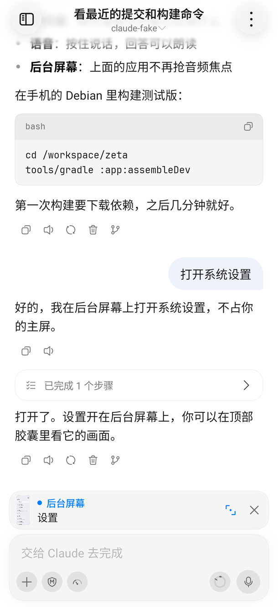

# Zeta

Zeta 是 root 过的 Android 手机上 [Claude Code](https://github.com/anthropics/claude-code) 的原生客户端：它在手机里装好 Debian 和 Claude Code，你用一个 ColorOS 风格的原生界面和 Claude 对话，Claude 也能在后台操作这台手机。

> Zeta 是个人维护的非官方项目。Claude 是 Anthropic 的商标；Zeta 不是 Anthropic 的产品，与 Anthropic 没有关联。

## 能做什么

- **原生的对话界面**：Markdown、代码块和公式照手机屏幕排版；思考、工具调用、子代理、后台任务都能点开看；会话列表能改名、归档、置顶、导出，能从中间改写一条消息重来。
- **自带 Linux 环境**：一键装好 Debian、Claude Code 和常用工具（Go、Node.js、Python 等可选），Claude Code 的配置（记忆、Skills、MCP、Subagent、工具权限）在设置里就能改。
- **远程主机**：Claude Code 也可以跑在别的 Linux 主机上，经手机 Debian 里的 OpenSSH 连，或者用 Zeta 自带的 SSH 直连。
- **和电脑上的终端交接**：同一个会话可以在电脑终端里的 `claude` 和 Zeta 之间来回接着用（两轮之间交接）。会话正在终端里开着时，Zeta 里点「接管会话」，那边像 `/exit` 一样退出；远程主机上在 Zeta 里起的会话，在那台的 tmux 会话 `zeta` 里各有一个窗口，回到电脑前 `tmux attach -t zeta` 回车就接着。终端里 `claude --resume` 接回时，要让 Zeta 那边自动让出来，在那台主机的 Claude Code 设置里登记一个 SessionStart hook（见下）。
- **操作手机**：Claude 在后台虚拟屏上开应用、读屏、点按，不占你正在用的屏幕，你随时可以暂停或接管；也能查通知、日程、文件、健康数据这类信息。手机操作可以整个关掉，单个工具也能在工具权限里设成每次询问或不许用。
- **关掉也照样跑**：对话跑在 Debian 里，Zeta 被系统杀掉也不中断，下次打开接着看；顶部胶囊、实时通知和屏幕底部的结果卡片随时告诉你进展。
- **语音与数字助理**：按住发送键说话、朗读回答，只用手机自带的识别和朗读服务；可以设成系统的默认数字助理，带着当前屏幕问 Claude（HyperOS 上配合 LSPosed 可以长按电源键唤起）。
- **定时任务**：到点自动开一轮对话，或者在收到某类通知时触发。

## 截图

截图来自 Android 模拟器上的测试版，回答是按剧本回话的假 Claude 给的（`tools/phone-tests/readme-shots.sh`）。

<p>
  
  
  
  
</p>

## 设备要求

- Android 15 或更新，arm64（arm64-v8a）。
- root：KernelSU（含 SukiSU 等分支）或 Magisk。Linux 环境、后台虚拟屏和一键授权都要 root，没有 root 的手机用不了 Zeta 的大部分功能（远程主机的 SSH 直连除外）。
- 可选：LSPosed。Zeta 自带一个 LSPosed 模块，只在 HyperOS 上有用：长按电源键唤起 Zeta，以及调用系统应用开放给系统智能体的工具。
- HyperOS 专有的功能：小米的语音识别服务、长按电源键、小米便签和系统应用的工具。别的系统上这些用不了，其余功能照常。
- 存储：Debian 环境和工具装在手机的 `/data/local/zeta` 下，装之前留够空间。

## 安装

1. 从 [GitHub Releases](https://github.com/dzshzx/Zeta/releases) 下载最新的 `Zeta-vX.Y.Z.apk`，同一页还有它的 `.sha256`。
2. 装之前核对签名证书（`apksigner` 在 Android SDK 的 build-tools 里）：

   ```bash
   sha256sum -c Zeta-vX.Y.Z.apk.sha256
   apksigner verify --print-certs Zeta-vX.Y.Z.apk
   ```

   `Signer #1 certificate SHA-256 digest` 应当是：

   ```
   1b89b1ab1d2274b98847c466b19bbf51f9ef997cb08956d9ed4b4caa7fba2403
   ```

   v0.7.0 及更早的版本是另一张证书签的，新版本带着签名轮换记录，可以直接覆盖安装，不用卸载。
3. 安装，打开 Zeta，在 root 管理器里给它授予超级用户。

也可以用 [Obtainium](https://github.com/ImranR98/Obtainium) 添加 `https://github.com/dzshzx/Zeta`，跟踪 Releases 的新版本。

## 第一次使用

1. **装 Linux 环境**：按 Zeta 的引导安装（之后在 设置 › 设备 里点这台手机，进「Linux 环境」维护）。它下载固定版本的 Debian rootfs 并校验，建一个 Linux 用户（默认叫 `zeta`），再装 Claude Code 和你选的工具。
2. **登录 Claude Code**：环境装好后按提示登录，走的是 Claude Code 自己的登录流程（`claude auth login`）。也可以在 Debian 里给 Claude Code 配别的 API 提供方，Zeta 不管这一层。
3. **授予权限**：设置 › 手机与工具 › 权限健康 里能看到每项权限的状态，有 root 时大多一键就能授予。只想聊天、不让 Claude 操作手机的话，除了 root 都可以不开。

### 终端接回时让 Zeta 让出会话

在远程主机的 `~/.claude/settings.json` 的 `hooks` 里加上（Zeta 连过这台主机后 `zeta-helper` 就装好了）：

```json
"SessionStart": [
  {
    "matcher": "resume",
    "hooks": [
      {
        "type": "command",
        "command": "h=~/.cache/zeta/bin/zeta-helper; [ -x \"$h\" ] || h=~/.cache/zeta-dev/bin/zeta-helper; [ -x \"$h\" ] && exec \"$h\" session-start; exit 0",
        "timeout": 30
      }
    ]
  }
]
```

终端里接着一个会话时，Zeta 那边闲着就退出；正在回答时终端里会提示先等它答完。

## 权限说明

| 权限 | 用来做什么 |
|---|---|
| root | 进 Debian 环境（挂载、chroot、降到普通 Linux 用户）、建后台虚拟屏、替你一键授予下面这些权限 |
| 无障碍服务 | Claude 读屏、点按；顶部胶囊、屏幕边缘流光和结果卡片也画在无障碍服务的悬浮层上，所以 Zeta 不要悬浮窗权限 |
| 通知 | 对话在跑时的常驻通知（回答时提升为实时通知）；每个对话一条完成和需要你处理时的提醒，等批准时能在通知上直接允许或拒绝，只有一道单选题时能直接选答案（锁屏上要先解锁） |
| 通知使用权、通知历史 | 通知触发的定时任务收通知；让 Claude 查已经划掉的通知（比如找验证码） |
| 后台运行（电池优化） | 长时间息屏时不被系统限制 |
| 精确闹钟、自启动 | 定时任务准时开始；手机重启后定时任务重新排上 |
| 麦克风 | 按住发送键说话 |
| 健康数据（健康连接，只读） | Claude 读步数、睡眠、心率这类汇总 |
| 后台弹出界面（HyperOS） | 从顶部胶囊点对话标题回到 Zeta |
| 网络 | Claude Code 连模型、装环境时下载、连远程主机、检查更新 |

## 隐私

- Zeta 不收集任何数据：没有统计、广告、崩溃上报，也没有 Zeta 自己的服务器。
- 对话内容只经 Claude Code 发给 Anthropic（或你在 Claude Code 里配置的 API 提供方）；会话记录由 Claude Code 存在手机 Debian 里，Zeta 不往别处传。
- 手机工具读到的个人数据（屏幕内容、通知、文件、健康数据等）会作为工具结果发给模型。不想让模型看到的，在工具权限里禁用对应的工具，或者关掉手机操作。
- Zeta 自己联网只做这几件事：装环境时从 Debian 镜像（清华 TUNA 镜像或 deb.debian.org）、claude.ai、GitHub 和各工具的官方或国内镜像站下载（GitHub 连不上时经 gh-proxy.com 中转）；连你添加的远程主机；检查更新时访问 GitHub 和 gh-proxy.com。

## 从源码构建

要 JDK 25、Android SDK 和 Go（版本见 `helper/go.mod`）。`tools/gradle :app:assembleDebug` 构建测试版（包名 `com.dzshzx.zeta.dev`，和正式版能同时装）。构建、测试、设备脚本和本机配置的细节见 [CLAUDE.md](CLAUDE.md) 的「本机配置」「构建与测试」两节；这份文件也是给 Claude Code 在本仓工作时读的开发说明。发版流程见 [docs/release.md](docs/release.md)。

## 反馈

Bug 和功能建议请提 [Issue](https://github.com/dzshzx/Zeta/issues)，安全问题见 [SECURITY.md](SECURITY.md)，参与方式见 [CONTRIBUTING.md](CONTRIBUTING.md)。

## 鸣谢

- [Eta](https://github.com/Mangi-11/Eta)：Zeta 的功能和交互照它设计，Markdown 渲染、侧栏骨架等代码来自它（GPL-3.0）。
- [COUI 2](https://github.com/suqi8/coui) 和它的上游 [Miuix](https://github.com/compose-miuix-ui/miuix)：界面组件库。
- [Claude Code](https://github.com/anthropics/claude-code)：Zeta 就是它在手机上的客户端。

## 许可证

Zeta 按 [GPL-3.0-only](LICENSE) 授权。APK 里带的第三方组件和它们的许可证见 [THIRD_PARTY.md](THIRD_PARTY.md)，应用里 设置 › 关于 › 开源许可 也能看。

## English

Zeta is an unofficial native Android client for [Claude Code](https://github.com/anthropics/claude-code) on rooted phones. It installs Debian and Claude Code on the phone, gives you a native ColorOS-style chat UI, and lets Claude operate the phone on a background virtual display. It can also run Claude Code on remote Linux hosts over SSH.

- Requirements: Android 15+, arm64, root (KernelSU or Magisk). LSPosed is optional and only used for HyperOS features.
- Install: download the APK from [Releases](https://github.com/dzshzx/Zeta/releases) and check that `apksigner verify --print-certs` reports the certificate SHA-256 `1b89b1ab1d2274b98847c466b19bbf51f9ef997cb08956d9ed4b4caa7fba2403`. Obtainium can track the releases.
- Privacy: Zeta collects no data. Conversations go to Anthropic only through Claude Code; personal data read by the phone tools is sent to the model as tool results. Update checks contact GitHub and gh-proxy.com.
- The UI and documentation are in Chinese.
- License: GPL-3.0-only; third-party components are listed in [THIRD_PARTY.md](THIRD_PARTY.md).

Claude is a trademark of Anthropic. Zeta is not an Anthropic product and is not affiliated with Anthropic.
