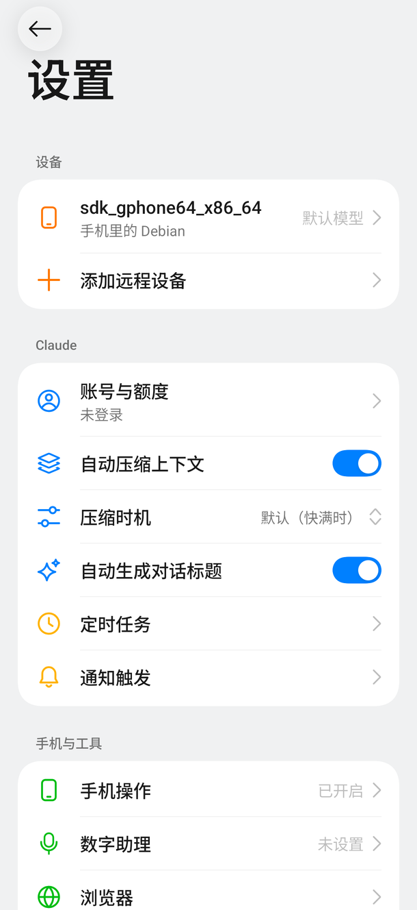

# Zeta

Zeta 是面向多个 Code Agent 的跨平台原生客户端，目前支持 [Claude Code](https://github.com/anthropics/claude-code) 与 [Antigravity CLI](https://antigravity.google)（`agy`），覆盖 Windows、Android 和 iOS。

主力场景是经 SSH 连接远程 Linux 主机上的 Code Agent 进行开发，多端共用 Go 核心，同一会话可在电脑与手机间同步和交接；在 Android 端还具备手机操作能力与可选的本机 Linux 环境。

各端分别使用原生界面框架：Windows 为 Go + mygo，Android 为 Kotlin + Jetpack Compose + Miuix，iOS 为 Swift + SwiftUI。

> Zeta 是个人维护的非官方项目。Claude 是 Anthropic 的商标，Google 与 Antigravity 是 Google 的商标；Zeta 与 Anthropic、Google 没有关联。

## 能做什么

### 多端共有（远程开发主力场景）

- **远程主机与多端同步**：经 SSH 连接一台或多台 Linux 开发机上的 Code Agent，电脑和手机可同时附着同一个会话，断线重连不丢进度。
- **多 Code Agent 共存与统一会话**：同一台设备可同时安装并使用 Claude Code 与 Antigravity CLI，会话统一在同一列表中管理（`agy` 会话标有 `agy`），新对话发消息前可自由切换工具，也可按设备设默认工具。
- **原生对话与任务界面**：Markdown、代码块与数学公式按平台原生排版；思考过程、工具调用、子代理与后台任务均可展开查看与控制；支持会话改名、归档、置顶、搜索、导出，以及从任意轮次改写或分支重来。
- **工具配置与账号管理**：按工具直接读写各自的真实配置（Claude Code 的记忆与 `CLAUDE.md`、Antigravity 的全局/工作区规则 `AGENTS.md`、Skills、MCP、Subagent 与工具权限）；各台设备分工具独立管理账号、额度与第三方中转（支持 Claude 登录与中转，也支持 Antigravity 的远程 Google OAuth 登录、订阅/积分额度查看与 Gemini API Key 中转）。
- **与终端无缝交接**：同一个会话可在远程终端里的 `claude` / `agy` 与 Zeta 之间来回接力（两轮之间交接）。会话正在终端里开着时，Zeta 里点「接管会话」，那边退出交回；Zeta 发起的远程会话会在主机的 tmux 会话 `zeta` 中维护对应窗口，回到电脑前 `tmux attach -t zeta` 回车即可继续。终端接回时也可通过 `SessionStart` hook 让 Zeta 自动让出（见下）。

### Android 端扩展能力

- **手机操作**：让 Code Agent 在后台虚拟屏上打开应用、读屏与点按，不占用主屏，随时可暂停或接管；也支持读取通知、日程、文件、健康数据等信息（可整体关闭或按单个工具设权限）。
- **可选的本机 Linux 环境**：在有 root 的手机上可一键安装 Debian、本地 Code Agent 与常用开发工具（Go、Node.js、Python 等）；对话跑在 Debian 内，应用被系统回收也不中断，配合顶部胶囊、超级岛和底部结果卡片随时查看进展。只连远程主机时可跳过此步骤，直接用内置 SSH 直连。
- **语音与数字助理**：按住发送键说话、朗读回答（只用手机自带的识别与朗读服务）；可设为系统默认数字助理，带着当前屏幕直接提问（HyperOS 配合 LSPosed 支持长按电源键唤起）。
- **定时任务与通知触发**：按时间自动发起对话，或在收到指定通知时自动触发（可指定在手机本机或某台远程主机执行）。

### Windows 桌面版与 iOS 版

- **Windows 桌面版**：Go + mygo 原生窗口，提供可拖拽侧栏、右键菜单、多选、全套快捷键、系统托盘与独立 MSI 安装及应用内更新（见下文「Windows 桌面版」）。
- **iOS 版**：Swift + SwiftUI 原生界面，支持 SSH 直连远程主机、完整的多工具会话/配置/账号管理与灵动岛实时活动（见 [docs/ios.md](docs/ios.md)）。

## 截图

截图来自 Android 模拟器上的测试版，回答是按剧本回话的假 Claude 给的（`tools/phone-tests/readme-shots.sh`）。

<p>
  
  
  
  
</p>

## 设备要求

- **远程 Linux 主机**（各端主力开发场景）：arm64 或 x86-64 的 Linux，安装 `bash`、coreutils，以及 Claude Code 或 Antigravity CLI（`agy`）中至少一个。
- **Windows 桌面版**：Windows x64，使用本机 OpenSSH 配置与 `~/.ssh` 密钥直连远程主机。
- **iOS 版**：iOS 27 或更新，使用内置 Ed25519 密钥或导入私钥直连远程主机。
- **Android 版**：Android 15 或更新，arm64（arm64-v8a）。仅经 SSH 直连远程主机时**不需要 root**；使用本机 Debian 环境、后台虚拟屏、手机操作与一键授权需要 root（KernelSU / SukiSU / Magisk），并在手机 `/data/local/zeta` 预留足够存储空间。
- **可选（HyperOS）**：LSPosed 模块仅用于 HyperOS 专属增强（长按电源键唤起、调用系统应用开放给系统智能体的工具、通知上超级岛并自动展开）；小米语音识别、小米便签等 HyperOS 专有能力在其他系统上不可用，其余功能照常。

## 安装

1. 从 [GitHub Releases](https://github.com/dzshzx/Zeta/releases) 下载最新的 `Zeta-vX.Y.Z.apk`，同一页还有它的 `.sha256`。
2. 装之前核对签名证书（`apksigner` 在 Android SDK 的 build-tools 里）：

   ```bash
   sha256sum -c Zeta-vX.Y.Z.apk.sha256
   apksigner verify --print-certs Zeta-vX.Y.Z.apk
   ```

   `Signer #1 certificate SHA-256 digest` 应当是：

   ```
   1b89b1ab1d2274b98847c466b19bbf51f9ef997cb08956d9ed4b4caa7fba2403
   ```

   v0.7.0 及更早的版本是另一张证书签的，新版本带着签名轮换记录，可以直接覆盖安装，不用卸载。
3. 安装，打开 Zeta，在 root 管理器里给它授予超级用户。

也可以用 [Obtainium](https://github.com/ImranR98/Obtainium) 添加 `https://github.com/dzshzx/Zeta`，跟踪 Releases 的新版本。

## 第一次使用

1. **装 Linux 环境**：按 Zeta 的引导安装（之后在 设置 › 设备 里点这台手机，进「Linux 环境」维护）。它下载固定版本的 Debian rootfs 并校验，放进一个磁盘镜像（稀疏文件，用多少占多少；手机开机时不用逐个重核里面文件的安全标签），建一个 Linux 用户（默认叫 `zeta`），再装 Claude Code 和你选的工具。
2. **登录 Claude Code**：环境装好后按提示登录，走的是 Claude Code 自己的登录流程（`claude auth login`）。也可以在 Debian 里给 Claude Code 配别的 API 提供方，Zeta 不管这一层。
3. **授予权限**：设置 › 手机与工具 › 权限健康 里能看到每项权限的状态，有 root 时大多一键就能授予。只想聊天、不让 Claude 操作手机的话，除了 root 都可以不开。

### 终端接回时让 Zeta 让出会话

Claude Code 在远程主机的 `~/.claude/settings.json` 的 `hooks` 里加上（Zeta 连过这台主机后 `zeta-helper` 就装好了）：

```json
"SessionStart": [
  {
    "matcher": "resume",
    "hooks": [
      {
        "type": "command",
        "command": "h=~/.cache/zeta/bin/zeta-helper; [ -x \"$h\" ] || h=~/.cache/zeta-dev/bin/zeta-helper; [ -x \"$h\" ] && exec \"$h\" session-start; exit 0",
        "timeout": 30
      }
    ]
  }
]
```

Antigravity CLI（可选）在远程主机的 `~/.gemini/antigravity-cli/settings.json` 的 `hooks` 里加上：

```json
"hooks": {
  "SessionStart": [
    {
      "type": "command",
      "command": "h=~/.cache/zeta/bin/zeta-helper; [ -x \"$h\" ] || h=~/.cache/zeta-dev/bin/zeta-helper; [ -x \"$h\" ] && exec \"$h\" session-start; exit 0",
      "timeout": 30
    }
  ]
}
```

终端里接着一个会话时，Zeta 那边闲着就退出；正在回答时终端里会提示先等它答完。

## Windows 桌面版

桌面版是 Windows 上的原生窗口程序（Go 写的），只经 SSH 用远程 Linux 主机上的 Claude Code 与 Antigravity CLI：左边是会话列表，右边是聊天，手机一侧的功能（Linux 环境、手机工具、语音）都不带。会话、确认、子代理和后台任务能看到的和手机上一样，界面照 ChatGPT 的 Windows 客户端：能拖宽、能收起的侧栏，右键菜单和 Ctrl、Shift 多选，一套快捷键（设置「常规」里列着）。

- 安装：从 Releases 下载 `Zeta-vX.Y.Z.msi`，双击安装。它装在你自己的用户目录下（`%LOCALAPPDATA%\Programs\Zeta`），不要管理员，也不用另装运行时。安装包没做代码签名，第一次运行时 Windows 的 SmartScreen 会提示。
- 更新：设置 › 关于里检查更新，有新版本时点「更新」，Zeta 下载安装包、核对校验值后退出，装好自动重新打开；也可以打开自动检查，每天第一次启动时查一次。
- 第一次使用：点「添加设备」，从这台电脑的 SSH 配置里导入一台，或手动输入 `用户@主机[:端口]`。Zeta 用这台电脑的 OpenSSH 配置和 `~/.ssh` 里的密钥登录，不另生成密钥；每台设备也能另选 `~/.ssh` 里的一把私钥；设了口令的私钥和跳板机暂不支持。主机上要装好 Claude Code 或 Antigravity CLI 并完成登录或配置。
- 设置存在 `%APPDATA%\Zeta`。

## 权限说明

| 权限 | 用来做什么 |
|---|---|
| root | 进 Debian 环境（挂载、chroot、降到普通 Linux 用户）、建后台虚拟屏、替你一键授予下面这些权限 |
| 无障碍服务 | Claude 读屏、点按；顶部胶囊、屏幕边缘流光和结果卡片也画在无障碍服务的悬浮层上，所以 Zeta 不要悬浮窗权限 |
| 通知 | 每个对话一条通知：回答时显示当前步骤，等你、跑完都在这一条上更新，装了 Zeta 的 LSPosed 模块时上小米超级岛；等批准时能在通知上直接允许或拒绝，只有一道单选题时能直接选答案（锁屏上要先解锁）。对话在跑时另有一条保活的通知，折叠在通知栏底部 |
| 通知使用权、通知历史 | 通知触发的定时任务收通知；让 Claude 查已经划掉的通知（比如找验证码） |
| 后台运行（电池优化） | 长时间息屏时不被系统限制 |
| 精确闹钟、自启动 | 定时任务准时开始；手机重启后定时任务重新排上 |
| 麦克风 | 按住发送键说话 |
| 健康数据（健康连接，只读） | Claude 读步数、睡眠、心率这类汇总 |
| 后台弹出界面（HyperOS） | 从顶部胶囊点对话标题回到 Zeta |
| 网络 | Claude Code 连模型、装环境时下载、连远程主机、检查更新 |

## 隐私

- Zeta 不收集任何数据：没有统计、广告、崩溃上报，也没有 Zeta 自己的服务器。
- 对话内容只经 Claude Code 或 Antigravity CLI 发给对应的模型服务方（或你在工具里配置的中转接入点）；会话记录由工具各自存在主机或手机 Debian 里，Zeta 不往别处传。
- 手机工具读到的个人数据（屏幕内容、通知、文件、健康数据等）会作为工具结果发给模型。不想让模型看到的，在工具权限里禁用对应的工具，或者关掉手机操作。
- Zeta 自己联网只做这几件事：装环境时从 Debian 镜像（清华 TUNA 镜像或 deb.debian.org）、claude.ai、GitHub 和各工具的官方或国内镜像站下载（GitHub 连不上时经 gh-proxy.com 中转）；连你添加的远程主机；检查更新时访问 GitHub 和 gh-proxy.com。

## 从源码构建

要 JDK 25、Android SDK 和 Go（版本见 `helper/go.mod`）。`tools/gradle :app:assembleDebug` 构建测试版（包名 `com.dzshzx.zeta.dev`，和正式版能同时装）。构建、测试、设备脚本和本机配置的细节见 [AGENTS.md](AGENTS.md) 的「本机配置」「构建与测试」两节；这份文件也是给 Claude Code 与 Antigravity 在本仓工作时读的开发说明。发版流程见 [docs/release.md](docs/release.md)。Windows 桌面版（`windows/`）在 Linux 上开发和打包：先 `hub/scripts/assets.sh`，再 `windows/installer/build.sh [输出目录]`，要 wixl（Debian/Ubuntu 的 `wixl` 包），产物是 `Zeta-v<版本>.msi`（默认在 `windows/build/`）；设计和测试见 [docs/desktop.md](docs/desktop.md)。iOS 版（`ios/`）只在 GitHub 托管的 macOS 上构建（`.github/workflows/ios.yml`），产物是不签名的 ipa，见 [docs/ios.md](docs/ios.md)。

## 反馈

Bug 和功能建议请提 [Issue](https://github.com/dzshzx/Zeta/issues)，安全问题见 [SECURITY.md](SECURITY.md)，参与方式见 [CONTRIBUTING.md](CONTRIBUTING.md)。

## 鸣谢

- [Eta](https://github.com/Mangi-11/Eta)：早期参考项目，Android 端的 Markdown 渲染、侧栏骨架等部分代码改写自它（GPL-3.0）。
- [Miuix](https://github.com/compose-miuix-ui/miuix)：Android 端界面组件库（HyperOS 风格）。
- [mygo](https://github.com/egoist/mygo)：Windows 桌面端原生界面框架，以及各端共用的多语言文字表工具。
- [COUI 2](https://github.com/suqi8/coui)：Android 端长按菜单的手势代码与桌面端部分图标路径取自它（Apache-2.0）。
- [Claude Code](https://github.com/anthropics/claude-code) 与 [Antigravity CLI](https://antigravity.google)：Zeta 当前支持的两款 Code Agent。

## 许可证

Zeta 按 [GPL-3.0-only](LICENSE) 授权。APK 里带的第三方组件和它们的许可证见 [THIRD_PARTY.md](THIRD_PARTY.md)，应用里 设置 › 关于 › 开源许可 也能看。

## English

Zeta is an unofficial cross-platform native client for multiple Code Agents — currently supporting [Claude Code](https://github.com/anthropics/claude-code) and [Antigravity CLI](https://antigravity.google) (`agy`) — on Windows, Android, and iOS.

Its primary focus is remote development: connecting over SSH to Code Agents running on Linux hosts, managing sessions from multiple agents side by side, and handing sessions off seamlessly between desktop, phone, and terminal. On Android, Zeta also offers phone-operation capabilities on a background virtual display and an optional on-device Debian environment.

Each platform uses a native UI stack on top of a shared Go core: Windows uses Go + mygo, Android uses Kotlin + Jetpack Compose + Miuix, and iOS uses Swift + SwiftUI.

- Requirements: A remote Linux host (arm64 or x86-64) with bash and Claude Code or Antigravity CLI for remote development. Windows (x64), iOS 27+, and Android 15+ (arm64) connect over SSH without root; root (KernelSU or Magisk) is only required on Android for the optional local Debian environment and phone-operation features. LSPosed is optional for HyperOS-specific features.
- Install: Download the APK or MSI from [Releases](https://github.com/dzshzx/Zeta/releases). For Android, verify `apksigner verify --print-certs` reports SHA-256 `1b89b1ab1d2274b98847c466b19bbf51f9ef997cb08956d9ed4b4caa7fba2403`. Obtainium can track APK releases.
- Privacy: Zeta collects no data. Conversations go only through the configured Code Agents to their model providers; personal data read by Android phone tools is sent to the model as tool results. Update checks contact GitHub and gh-proxy.com.
- License: GPL-3.0-only; third-party components are listed in [THIRD_PARTY.md](THIRD_PARTY.md).

Claude is a trademark of Anthropic; Google and Antigravity are trademarks of Google. Zeta is not affiliated with Anthropic or Google.
